<!-- ══════════════════════════════════════════════════════════ -->
<!--            VASANTH KUMAR · PREMIUM GITHUB PROFILE          -->
<!--        Minimal · Animated · Dark · Senior-level polish      -->
<!-- ══════════════════════════════════════════════════════════ -->

<div align="center">

<!-- ─── ANIMATED BANNER ─── -->


<!-- ─── TYPING ANIMATION ─── -->


<br/>

<!-- ─── STATUS LINE ─── -->


<a href="mailto:vasanthkumar744896@gmail.com"></a>


</div>

<br/>

<!-- ─── ABOUT · terminal style ─── -->
```console
vasanth@dev:~$ whoami
Full Stack Developer — Python-first backend engineer who builds AI-powered systems

vasanth@dev:~$ cat stack.yml
backend:   [Python, FastAPI, Node.js, REST]
frontend:  [React, Next.js, TypeScript, Tailwind]
database:  [PostgreSQL, MySQL, MariaDB, Redis]
devops:    [Docker, Linux, Nginx, CI/CD]
ai:        [YOLOv8, OpenCV, TensorFlow, Pandas, NumPy]

vasanth@dev:~$ echo $FOCUS
Scalable APIs · Computer Vision · LLM integrations
```

<!-- ─── 🕹️ CONTRIBUTION ARCADE · generated daily from real commits ─── -->
## 🕹️ Contribution Arcade

<div align="center">

<!-- 🧱 BREAKOUT — paddle smashing through my commit history -->
<picture>
  <source media="(prefers-color-scheme: dark)" srcset="https://raw.githubusercontent.com/vasu744896/vasu744896/output/breakout-contribution-graph-dark.svg"/>
  
</picture>

<!-- 👾 PAC-MAN — chasing ghosts across my contribution grid -->
<picture>
  <source media="(prefers-color-scheme: dark)" srcset="https://raw.githubusercontent.com/vasu744896/vasu744896/output/pacman-contribution-graph-dark.svg"/>
  
</picture>

<sub>Every brick and pellet is a real commit — regenerated daily by GitHub Actions.</sub>

</div>

<br/>

<div align="center">

<!-- ─── SKILLS · one clean line per layer ─── -->

<br/>

<br/><br/>
<!-- Playwright isn't on skillicons.dev, so a matching dark badge instead -->


</div>

<br/>

<!-- ─── PROJECTS · compact, no clutter ─── -->
<div align="center">

| 🚀 Project | ⚙️ Stack | 💡 One-liner |
|:---|:---|:---|
| **AI Bank Statement Analyzer** | `FastAPI` `OCR` `PostgreSQL` `Docker` | Documents in → structured financial insight out |
| **Stock Analytics Platform** | `FastAPI` `Pandas` `PostgreSQL` | Real-time market data, engineered for speed |
| **CRM System** | `Frappe` `Docker` `MariaDB` | Full business CRM, containerized end-to-end |
| **YOLO Object Counter** | `YOLOv8` `OpenCV` `Python` | Real-time detection & counting on live video |
| **Job Scraper** | `Playwright` `PostgreSQL` | Automated pipelines that never miss a listing |
| **Next.js Dashboard** | `React` `Next.js` `TypeScript` | Typed, responsive, production-grade UI |

</div>

<br/>

<!-- ─── STATS · animated, balanced ─── -->
<div align="center">


</div>

<br/>

<!-- ─── CONNECT ─── -->
<div align="center">

<a href="https://github.com/vasu744896"></a>
<a href="mailto:vasanthkumar744896@gmail.com"></a>
<!-- 🔧 UPDATE: your LinkedIn URL -->
<a href="https://www.linkedin.com/in/UPDATE-YOUR-LINKEDIN"></a>

<br/><br/>

<!-- ─── ANIMATED FOOTER ─── -->


</div>