<!-- ============================================================ -->
<!--                 VASANTH KUMAR — GITHUB PROFILE               -->
<!--   Premium Dark Themed Profile README • Fully Copy-Pasteable  -->
<!-- ============================================================ -->

<!-- ====================== BANNER ====================== -->
<div align="center">


<!-- ====================== TYPING ANIMATION ====================== -->
<a href="https://github.com/vasu744896">

</a>

<br/>

<!-- ====================== VISITOR COUNTER ====================== -->


<br/><br/>

<!-- ====================== QUICK BADGES ====================== -->


</div>

<br/>


<!-- ====================== ABOUT ME ====================== -->
## 🧑‍💻 About Me


```python
class VasanthKumar:
    def __init__(self):
        self.name     = "Vasanth Kumar"
        self.role     = "Full Stack Developer"
        self.title    = ["Python Backend Engineer", "AI Enthusiast"]
        self.location = "India 🇮🇳"
        self.email    = "vasanthkumar744896@gmail.com"

    def current_stack(self):
        return {
            "backend":  ["Python", "FastAPI", "Node.js"],
            "frontend": ["React", "Next.js", "TypeScript"],
            "database": ["PostgreSQL", "MySQL", "Redis"],
            "devops":   ["Docker", "Linux", "Nginx", "CI/CD"],
            "ai_ml":    ["YOLOv8", "OpenCV", "TensorFlow"],
        }

    def say_hi(self):
        print("Thanks for dropping by! Let's build something great. 🚀")


me = VasanthKumar()
me.say_hi()
```

- 🔭 Building **production-grade backends** with FastAPI & PostgreSQL
- 🤖 Exploring **Computer Vision** with YOLOv8 & OpenCV
- 🐳 Shipping everything in **Docker containers**
- 💬 Ask me about **Python, REST APIs, and system design**
- 📫 Reach me at **vasanthkumar744896@gmail.com**

<br clear="right"/>


<!-- ====================== TECH STACK ====================== -->
## 🛠️ Tech Stack

<div align="center">

### 💻 Languages


### 🎨 Frontend


### ⚙️ Backend

<br/>


### 🗄️ Database

<br/>


### 🚀 DevOps

<br/>


### 🤖 AI / Machine Learning

<br/>


</div>


<!-- ====================== FEATURED PROJECTS ====================== -->
## 🚀 Featured Projects

<div align="center">

<table>
  <tr>
    <td width="50%" valign="top">
      <h3 align="center">🏦 AI Bank Statement Analyzer</h3>
      <p align="center">
        
        
        
        
      </p>
      <p align="center">Intelligent document pipeline that extracts, parses, and analyzes bank statements using OCR — fully containerized with Docker.</p>
    </td>
    <td width="50%" valign="top">
      <h3 align="center">📈 Stock Analytics Platform</h3>
      <p align="center">
        
        
        
      </p>
      <p align="center">Real-time stock data analytics with a high-performance FastAPI backend and Pandas-powered computation engine.</p>
    </td>
  </tr>
  <tr>
    <td width="50%" valign="top">
      <h3 align="center">🗂️ CRM System</h3>
      <p align="center">
        
        
        
      </p>
      <p align="center">Full-featured CRM built on the Frappe framework with Dockerized deployment and MariaDB persistence.</p>
    </td>
    <td width="50%" valign="top">
      <h3 align="center">🎯 YOLO Object Counter</h3>
      <p align="center">
        
        
        
      </p>
      <p align="center">Real-time object detection and counting system powered by YOLOv8 and OpenCV video pipelines.</p>
    </td>
  </tr>
  <tr>
    <td width="50%" valign="top">
      <h3 align="center">🕷️ Job Scraper</h3>
      <p align="center">
        
        
      </p>
      <p align="center">Automated job listing scraper using Playwright with structured storage in PostgreSQL.</p>
    </td>
    <td width="50%" valign="top">
      <h3 align="center">📊 Next.js Dashboard</h3>
      <p align="center">
        
        
        
      </p>
      <p align="center">Modern, responsive admin dashboard built with Next.js, React, and fully typed TypeScript.</p>
    </td>
  </tr>
</table>

<!-- 🔧 UPDATE: Add repo links to each project card, e.g. <a href="https://github.com/vasu744896/repo-name">View Repo →</a> -->

</div>


<!-- ====================== GITHUB STATS ====================== -->
## 📊 GitHub Analytics

<div align="center">


<br/><br/>


<br/><br/>


</div>

<br/>

<!-- ====================== TROPHIES ====================== -->
## 🏆 GitHub Trophies

<div align="center">


</div>


<!-- ====================== CONTRIBUTION SNAKE ====================== -->
## 🐍 Contribution Snake

<div align="center">

<!-- 🔧 UPDATE: Requires the snake workflow. Create .github/workflows/snake.yml in your profile repo
     using the Platane/snk action so this image is generated on your `output` branch. -->


</div>


<!-- ====================== CURRENT FOCUS ====================== -->
## 🎯 Current Focus

<div align="center">

| 🚧 Building | 📚 Learning | 🌱 Exploring |
|:---:|:---:|:---:|
| AI-powered document pipelines | System Design & Architecture | LLM integrations with FastAPI |
| Scalable FastAPI microservices | Kubernetes fundamentals | Vector databases & RAG |
| Real-time CV applications | Advanced TypeScript patterns | Edge deployment for ML models |

</div>

<br/>

<!-- ====================== TECH ROADMAP ====================== -->
## 🗺️ Tech Roadmap

```mermaid
graph LR
    A[🐍 Python Mastery] --> B[⚡ FastAPI at Scale]
    B --> C[🐳 Docker & CI/CD]
    C --> D[☸️ Kubernetes]
    D --> E[🤖 AI/ML in Production]
    E --> F[🏗️ System Design Expert]
    style A fill:#0d1117,stroke:#58a6ff,color:#58a6ff
    style B fill:#0d1117,stroke:#58a6ff,color:#58a6ff
    style C fill:#0d1117,stroke:#58a6ff,color:#58a6ff
    style D fill:#0d1117,stroke:#f78166,color:#f78166
    style E fill:#0d1117,stroke:#f78166,color:#f78166
    style F fill:#0d1117,stroke:#2ea043,color:#2ea043
```




<!-- ====================== DEVELOPMENT WORKFLOW ====================== -->
## ⚙️ Development Workflow

<div align="center">

```
 💡 Idea → 📋 Plan → 🧪 Prototype → 👨‍💻 Code → ✅ Test → 🐳 Containerize → 🚀 Deploy → 📊 Monitor → 🔁 Iterate
```

| Stage | Tools |
|:---|:---|
| 🧠 **Planning** | Notion, GitHub Projects, Excalidraw |
| 👨‍💻 **Development** | VS Code, Python, TypeScript |
| 🧪 **Testing** | Pytest, Postman |
| 🐳 **Containerization** | Docker, Docker Compose |
| 🚀 **Deployment** | Nginx, Linux VPS, GitHub Actions CI/CD |
| 📊 **Monitoring** | Logs, Health Checks, Uptime Monitors |

</div>

<br/>

<!-- ====================== CODING PRINCIPLES ====================== -->
## 🧭 Coding Principles

<div align="center">

| Principle | What it means to me |
|:---|:---|
| 🧹 **Clean Code** | Code is read far more often than it is written |
| 🧱 **KISS** | Simple solutions beat clever solutions |
| 🔁 **DRY** | Abstract only when patterns truly repeat |
| 🧪 **Test What Matters** | Confidence to refactor comes from tests |
| 📦 **Ship Small** | Small PRs, fast feedback, steady progress |
| 📖 **Docs Are Features** | If it isn't documented, it doesn't exist |

</div>

<br/>

<!-- ====================== TOOLS I USE DAILY ====================== -->
## 🧰 Tools I Use Daily

<div align="center">


</div>


<!-- ====================== OPEN SOURCE ====================== -->
## 🌍 Open Source Contributions

<div align="center">

💚 I believe in giving back to the community that taught me everything.

<!-- 🔧 UPDATE: Replace with links to your actual open source PRs / issues / repos -->
| Type | Contribution |
|:---|:---|
| 🐛 Bug Fixes | Fixing issues in Python & FastAPI ecosystem projects |
| 📖 Documentation | Improving docs and examples for tools I use |
| 🛠️ Tooling | Building and sharing developer utilities |
| ⭐ Community | Starring, testing, and reporting on OSS projects |

</div>

<br/>

<!-- ====================== FUN FACTS ====================== -->
## 🎉 Fun Facts

<div align="center">

🐍 &nbsp;I can debug faster with `print()` than most people can with a debugger<br/>
☕ &nbsp;My code quality is directly proportional to my coffee intake<br/>
🌙 &nbsp;Best commits happen after midnight (the git log doesn't lie)<br/>
🎯 &nbsp;I count objects with YOLO for fun — literally<br/>
🐳 &nbsp;"It works on my machine" → so I ship the machine (Docker)<br/>

</div>


<!-- ====================== QUOTE ====================== -->
## 💬 Quote of the Day

<div align="center">


</div>

<br/>

<!-- ====================== CONNECT ====================== -->
## 🤝 Connect With Me

<div align="center">

<a href="mailto:vasanthkumar744896@gmail.com">
  
</a>
<a href="https://github.com/vasu744896">
  
</a>
<!-- 🔧 UPDATE: Replace the LinkedIn URL below with your actual LinkedIn profile -->
<a href="https://www.linkedin.com/in/UPDATE-YOUR-LINKEDIN">
  
</a>
<!-- 🔧 UPDATE: Replace the Twitter/X URL below with your actual handle, or remove -->
<a href="https://twitter.com/UPDATE-YOUR-HANDLE">
  
</a>
<!-- 🔧 UPDATE: Replace with your portfolio URL, or remove -->
<a href="https://UPDATE-YOUR-PORTFOLIO.com">
  
</a>

<br/><br/>

💌 **Open to collaborations, freelance work, and interesting backend/AI projects!**

</div>

<!-- ====================== FOOTER ====================== -->
<br/>

<div align="center">


</div>